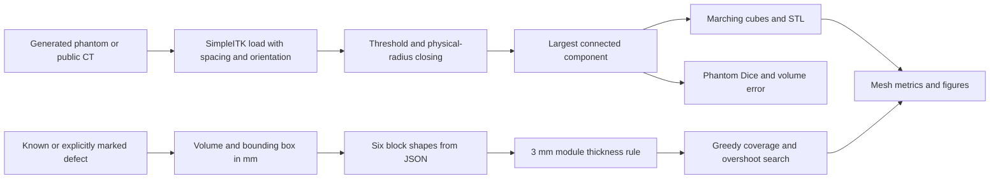
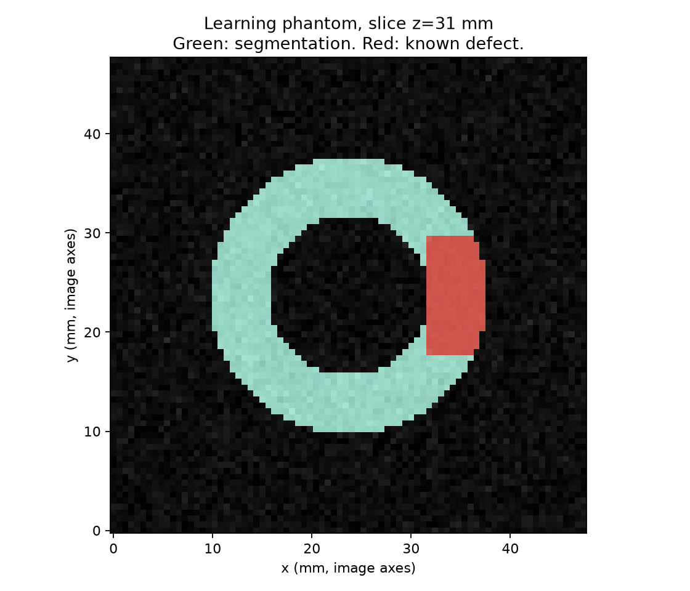
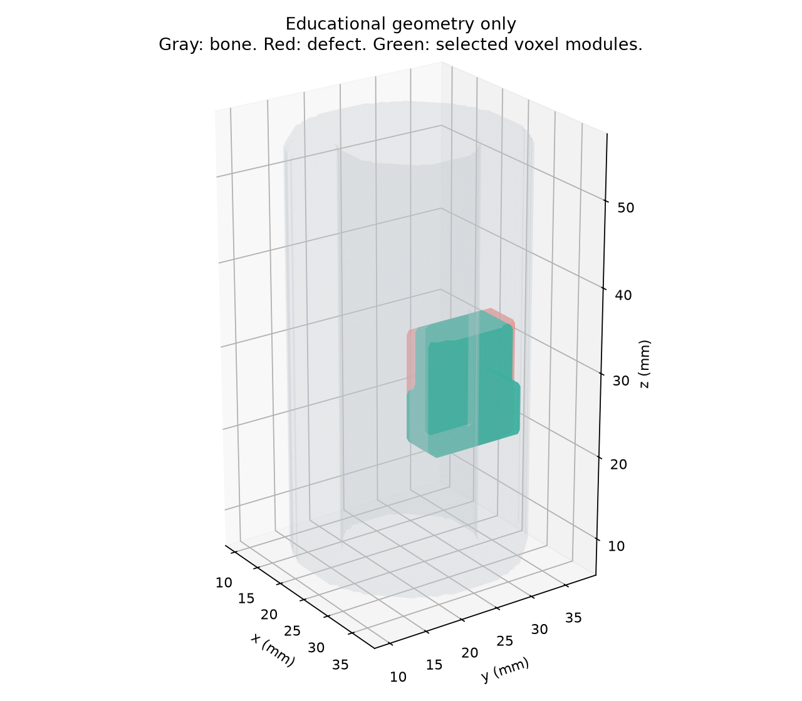

# bone-defect-planner

A Python learning prototype for threshold segmentation, defect geometry and fitting simple modular blocks. It uses a synthetic bone-like cylinder and an optional public CT sample. It does not train a model.

**Medical disclaimer:** This is not medical software. It is not validated for diagnosis, surgery, implant design, manufacturing or treatment planning. The block thickness rule is a geometric demonstration, not a biomechanical simulation or a safety check. Do not use the results to make decisions about a person.

## Pipeline



For the phantom, the defect mask is known from construction and independent of segmentation. The program does not discover a defect from a clinical image. The optional public demonstration removes a small artificial surface region. A separate `volume` command accepts an explicitly marked mask on the same image grid.

## Setup and run

Python 3.12, a normal virtual environment and pip are sufficient. No Docker, GPU, Slicer installation or data download is needed for the phantom or tests. The first package installation needs internet access. After that the phantom and tests work offline.

From this project folder on Windows PowerShell:

```powershell
py -3.12 -m venv .venv
.\.venv\Scripts\python.exe -m pip install -e ".[dev]"
.\.venv\Scripts\python.exe -m pytest -q
.\.venv\Scripts\python.exe -m bone_defect_planner demo --output artifacts --figures docs
```

On Linux/macOS use `python3.12 -m venv .venv` and `.venv/bin/python` in place of the Windows executable. If a restricted Windows environment blocks pytest's temporary directory, use `-m pytest -q --basetemp .pytest-temp`.

Follow [docs/STEPS.md](docs/STEPS.md) for ordered instructions and screenshot names. Local verification: **21 tests pass**. The GitHub Actions workflow runs tests and the phantom, then uploads outputs. **A remote Actions run is not yet confirmed.** No green CI badge is claimed.

## Data sources and licenses

| Data | Source | Permission/license | Used here |
| --- | --- | --- | --- |
| Three synthetic phantoms and truth masks | Generated by [phantom.py](src/bone_defect_planner/phantom.py), seed 7 | Original project content, [MIT](LICENSE) | Yes, primary evaluation |
| CT-brain.nrrd, CT portion of Slicer CT-MR Brain | [Pinned Slicer sample mapping](https://github.com/Slicer/Slicer/blob/v5.6.2/Modules/Scripted/SampleData/SampleData.py#L515) | Dataset-specific unrestricted-use permission stated by Slicer, [permission statement](https://github.com/Slicer/Slicer/blob/v5.6.2/Modules/Scripted/SampleData/SampleData.py#L77). No named SPDX data license stated. This is separate from Slicer's software license. | Downloaded, checksum verified and processed as a separate demonstration |

The CT is public data, not private patient data. It is a skull scan, not a long-bone defect dataset. It has no bone or defect ground truth supplied for this evaluation. The CT file and its large derived STL are not bundled in the source archive. [docs/DATA.md](docs/DATA.md) has the download URL, SHA256, exact size and attribution. The code and synthetic phantom are MIT licensed; that license does not relicense the third-party CT.

Optional reproduction:

```powershell
.\.venv\Scripts\python.exe tools/fetch_public_ct.py
.\.venv\Scripts\python.exe -m bone_defect_planner public-demo data/downloads/CT-brain.nrrd --output artifacts/public-ct
```

This downloads about 16 MB and can produce a roughly 71 MB STL. The checksum is checked before accepting the file. The threshold is 400 in stored intensity units. Independent Hounsfield-unit calibration has not been established. There is no clinical accuracy claim.

For an explicitly marked defect on a public scan:

```powershell
.\.venv\Scripts\python.exe -m bone_defect_planner volume scan.nii.gz --defect-mask defect-mask.nii.gz --threshold 400 --output artifacts/marked-volume
```

The nonzero mask labels the region to remove from the segmented bone and fit. Shape, spacing, origin and direction must match. The program rejects mismatched images or an empty mask. Use only openly permitted public data in this project.

## Geometry and selection rules

- Arrays are indexed **x, y, z**. SimpleITK's z, y, x array is transposed explicitly. Generated spacing is 0.6 x 0.6 x 1.0 mm. NIfTI headers can round those values slightly.
- Binary segmentation uses intensity >= 400, a 0.8 mm spherical closing footprint, then the largest 6-connected component. The high-intensity disconnected artifact is removed. Closing can also incorrectly bridge small gaps.
- Voxel volume is `voxel_count * sx * sy * sz`. Bounding boxes include full voxel cells, with half-voxel offsets. Their values are in image-axis millimetres. Physical world coordinates use `origin + direction @ local_mm`. SimpleITK preserves [image geometry](https://simpleitk.readthedocs.io/en/master/fundamentalConcepts.html).
- Marching cubes receives spacing and a zero-padded mask. Vertices are transformed to physical LPS coordinates. Enclosed cavities retain their winding so their volume is subtracted. STL has no reliable unit metadata; coordinates in these exports are intended as millimetres. Mesh volume is reported only for a valid closed volume. See [marching cubes](https://scikit-image.org/docs/stable/api/skimage.measure.html#skimage.measure.marching_cubes) and [trimesh geometry properties](https://trimesh.org/trimesh.html).
- [blocks.json](src/bone_defect_planner/blocks.json) defines four cuboids and two cylinders. Candidates use axis permutations or cylinder axes, a bounded grid of centres and at most four blocks. A solid module with minimum dimension below 3 mm is rejected. This is a minimum thickness proxy, not a wall, stress, fatigue or bone-quality analysis. The 2 mm thin plate fails this rule in every run.
- Selection greedily maximizes newly covered defect voxels minus newly added outside-defect voxels. It stops at 95% coverage, the four-block cap, or no improving candidate. This penalizes overshoot, but does not guarantee a global optimum.
- Coverage is `100 * occupied_defect_voxels / defect_voxels`. Overshoot is `100 * occupied_outside_defect_voxels / defect_voxels`. The denominator is the defect, so overshoot can exceed 100%. The union prevents double-counting. Module intersections are allowed and reported separately, as is overlap with remaining bone.
- The label `acceptable demo fit` means coverage >= 90% and overshoot <= 20%. It is an arbitrary geometric reporting threshold, not clinical acceptability. Connections, assembly order and manufacturability are not checked.

## Measured results

Actual local run, fixed seed 7, Python 3.12.14 on Windows. No model training or parameter tuning per case. Full values and block poses are in [results.json](artifacts/results.json) and [results.csv](artifacts/results.csv).

| Phantom | Segmentation Dice | Bone volume error | Known defect mm3 | Coverage | Overshoot | Blocks | Fit |
| --- | ---: | ---: | ---: | ---: | ---: | ---: | --- |
| nominal | 0.9998 | 0.050% | 889.20 | 90.36% | 3.56% | 4 | Acceptable demo fit |
| low_contrast | 0.9361 | 8.739% | 889.20 | 90.36% | 3.56% | 4 | Acceptable demo fit |
| thin_defect | 0.9999 | 0.011% | 205.20 | 72.63% | 40.35% | 1 | Poor fit |

Dice compares segmented remaining bone against the generated remaining-bone truth mask. Bone volume error is the absolute segmented-versus-truth difference divided by truth volume. Truth here means the digital voxel phantom, not an anatomical or continuous analytical reference. The nominal intact digital shell is 19,699.20 mm3 versus 19,905.13 mm3 for the corresponding continuous annular cylinder. This discretization difference is not counted as a segmentation error.

| Phantom | Bone mesh volume mm3 | Bone surface mm2 | Watertight | Defect mesh vs voxel volume error |
| --- | ---: | ---: | --- | ---: |
| nominal | 18,798.07 | 7,703.45 | Yes | 0.803% |
| low_contrast | 17,355.88 | 11,962.54 | Yes | 0.803% |
| thin_defect | 19,476.67 | 7,751.45 | Yes | 2.602% |

Voxel and marching-cubes volumes are different estimators, especially for small objects. Watertight only describes mesh topology and does not establish anatomical correctness.

The nominal and low-contrast runs each use two `box-10` and two `cube-6` modules. Their union covers 803.52 mm3 with 31.68 mm3 outside the target. Their modules overlap each other by 561.60 mm3. That interpenetration is a limitation, not a realistic modular joint. The thin case uses one `cylinder-6`, leaves 27.37% uncovered and intersects 80.64 mm3 of remaining bone. Good segmentation does not imply a good block fit. Identical module scores for nominal and low-contrast cases occur because fitting uses the same known defect mask, not the degraded segmentation.

Public CT demonstration: the artificial marked defect is 585.77 mm3. The selected four blocks cover 88.84% with 31.31% overshoot, a poor fit. Its [separate report](artifacts/public-ct/results.json) contains the mesh statistics and geometry. No Dice or true-volume error is reported because no reference annotation exists. This run is not evidence of clinical segmentation accuracy.

## Figures





## Tests and CI

Twenty-one pytest tests cover anisotropic volume and bounding boxes, half-voxel extents, empty inputs, Dice, physical I/O roundtrip, mesh bounds/watertightness, enclosed cavities, exact module fits, boundary ties, thickness rejection, deterministic union metrics, the three phantom cases and processing an external marked mask. The phantom integration test requires no download.

The local run passed all tests. Upstream scikit-image emits NumPy deprecation warnings; they are recorded, not hidden. [GitHub Actions](.github/workflows/tests.yml) is configured to install the project, run pytest, execute the offline demonstration and upload results/figures. The optional public CT is not downloaded in CI. The workflow has not been run remotely yet. See [verification.md](docs/verification.md) for actual execution scope.

## Limits and what I would change

- This is a learning prototype, not medical software. Synthetic noise and intensities do not model a scanner or human anatomy. Three deterministic cases do not establish general accuracy.
- Thresholding and largest-component cleanup can miss thin or disconnected real bone. The low-contrast case has an 8.739% volume error. I would compare a larger set of public reference masks and report failures by anatomy and acquisition setting.
- Defects are known or manually marked. The code cannot infer missing anatomy. I would keep explicit human annotation and compare different reference reconstructions before any clinical research claims.
- The block search is coarse, axis aligned and greedy. Modules can interpenetrate and collide with remaining bone. I would add collision constraints, non-overlapping assembly geometry, connection rules and a documented optimization objective.
- The minimum solid-module thickness rule does not check residual bone wall thickness or mechanical stability. A real structural study would require validated material parameters, loading, boundary conditions, suitable modeling and expert review. No such simulation is included.
- Voxel-centre rasterization and marching cubes introduce resolution error. I would test spacing convergence and compare digital and analytical shapes independently.
- Public CT intensity calibration is not independently verified. The skull example is only a separate I/O and geometry demonstration. It has no reference labels for accuracy metrics.
- A local passing test run does not mean GitHub Actions passed. Record the workflow URL and conclusion after the first real run. No remote run or fabricated screenshot is presented here.

## CV bullets, actual work only

- Ich habe einen Python-Lernprototypen mit SimpleITK, scikit-image und trimesh zur Segmentierung, Defektvermessung und STL-Erzeugung implementiert und an synthetischen Volumen sowie einem öffentlichen CT-Beispiel ausgeführt.
- Ich habe drei Phantomfälle ausgewertet und dabei unter anderem einen Dice-Wert von 0,9361 bei niedrigem Kontrast sowie eine unzureichende Modulpassung mit 72,63 Prozent Abdeckung und 40,35 Prozent Überstand gemessen.
- Ich habe 21 automatisierte Tests erfolgreich lokal ausgeführt und einen GitHub-Actions-Workflow für Tests, Phantom-Auswertung und Ergebnisartefakte eingerichtet.
